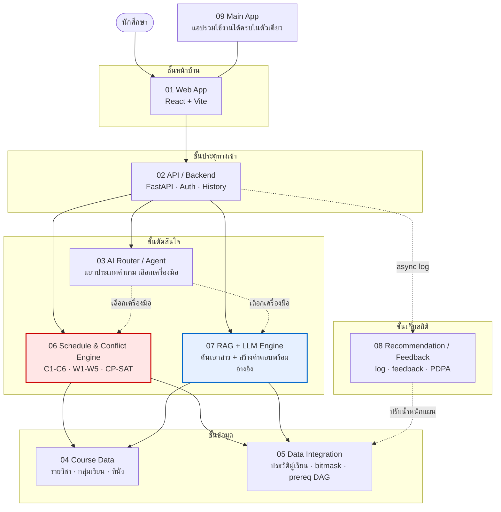
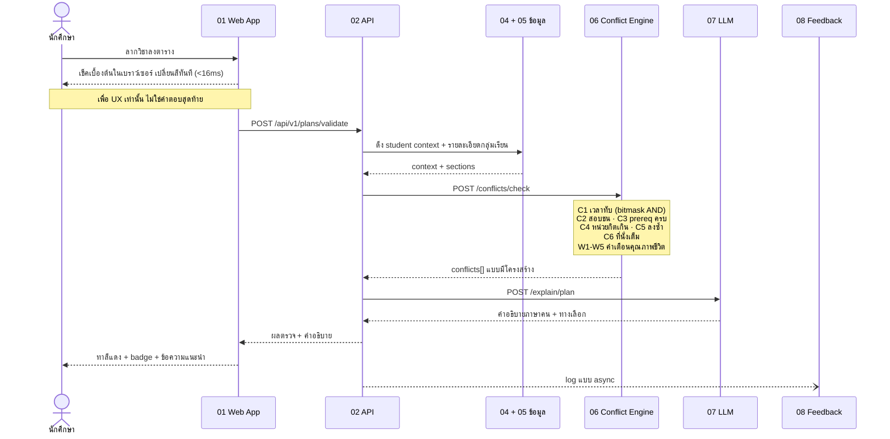
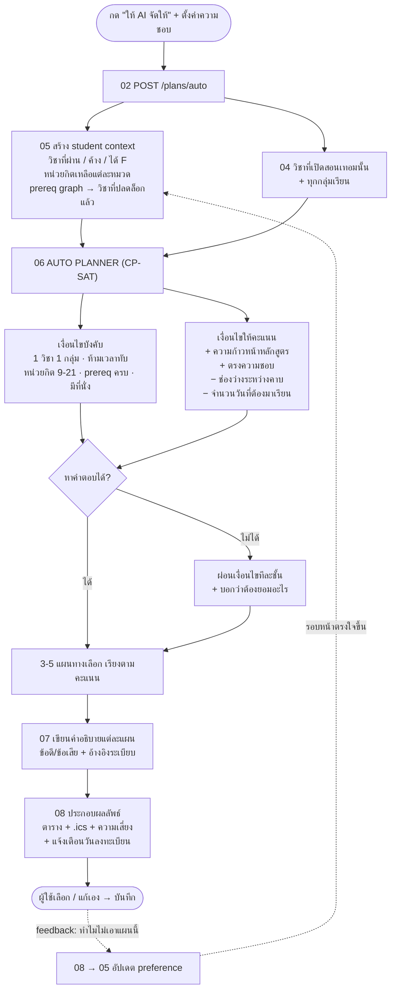
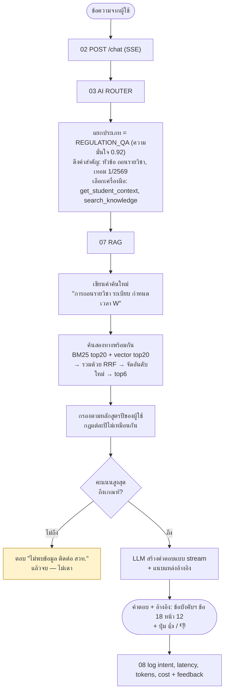
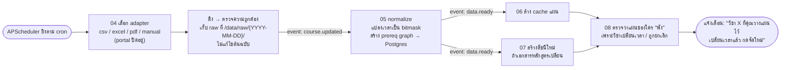
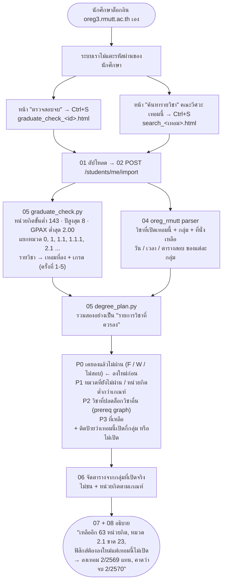
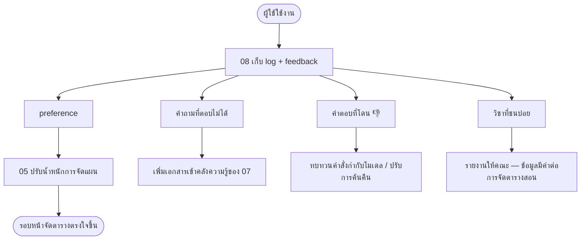

# ระบบวางแผนการเรียน มทร.ธัญบุรี — RMUTT Study Planner

โครงงานวิศวกรรมซอฟต์แวร์ สาขาวิศวกรรมคอมพิวเตอร์
มหาวิทยาลัยเทคโนโลยีราชมงคลธัญบุรี

ระบบช่วยนักศึกษาวางแผนการเรียน ตรวจตารางเรียนชน จัดตารางอัตโนมัติ
และถาม–ตอบเรื่องระเบียบการศึกษาโดยมีแหล่งอ้างอิงกำกับทุกคำตอบ

**เปิดเดโมได้เลย → https://rmutt-planner.noble-gold-society.workers.dev/**

---

## สารบัญ

- [เปิดดูเร็วที่สุด](#เปิดดูเร็วที่สุด)
- [ภาพรวมระบบ](#ภาพรวมระบบ)
- [Workflow การทำงาน](#workflow-การทำงาน)
- [Folder Structure](#folder-structure)
- [Module ใดใครทำอะไร](#module-ใดใครทำอะไร)
- [ทีมผู้พัฒนา](#ทีมผู้พัฒนา)
- [วิธีรันระบบ](#วิธีรันระบบ)
- [หลักการที่ยึดตลอดโครงงาน](#หลักการที่ยึดตลอดโครงงาน)
- [ข้อจำกัดที่ต้องบอกให้ชัด](#ข้อจำกัดที่ต้องบอกให้ชัด)

---

## เปิดดูเร็วที่สุด

| ช่องทาง | ลิงก์ | ต้องติดตั้งอะไร |
|---|---|---|
| เดโมออนไลน์ | [rmutt-planner.noble-gold-society.workers.dev](https://rmutt-planner.noble-gold-society.workers.dev/) | ไม่ต้อง |
| แผนภาพสถาปัตยกรรม | [architecture.html](https://rmutt-planner.noble-gold-society.workers.dev/architecture) | ไม่ต้อง |
| สไลด์บทที่ 7 (RAG + LLM) | [ch07.html](https://rmutt-planner.noble-gold-society.workers.dev/ch07) | ไม่ต้อง |
| ระบบเต็ม 9 โมดูล | `docker compose up -d --build` | Docker Desktop |

เดโมออนไลน์เป็นไฟล์เดียวจบ ทำงานในเบราว์เซอร์ล้วน ไม่ต้องต่อเซิร์ฟเวอร์:
จัดตารางเรียน ตรวจตารางชน และถาม–ตอบเรื่องระเบียบพร้อมแหล่งอ้างอิง

---

## ภาพรวมระบบ

ระบบแยกเป็น 9 โมดูลอิสระ แต่ละโมดูลเป็น service ของตัวเอง มี `Dockerfile`
และ `/health` ของตัวเอง คุยกันผ่าน HTTP ผ่านประตูทางเข้าเดียวคือโมดูล 02



กล่องสีแดงคือโมดูลที่ **ตัดสินเรื่องเวลา** ด้วยโค้ดล้วน
กล่องสีฟ้าคือโมดูลที่ **อธิบายผลลัพธ์** ด้วยโมเดลภาษา — สองหน้าที่นี้แยกกันเด็ดขาด

### บริการพื้นฐานที่ใช้ร่วมกัน

| บริการ | หน้าที่ |
|---|---|
| PostgreSQL | ข้อมูลผู้ใช้ รายวิชา แผนการเรียน ประวัติแชต |
| Redis | cache รายละเอียดกลุ่มเรียน ลดภาระโมดูล 04 |
| Prometheus | เก็บ metric ทุก service |
| Grafana | แดชบอร์ด `rmutt-overview` |

---

## Workflow การทำงาน

### Flow A — "ลงวิชานี้ชนไหม?" (ตรวจตารางชนแบบทันที) — ฟีเจอร์หลัก



ผลลัพธ์ที่ผู้ใช้เห็น:

> ENG101 ม.01 (จ. 09:00–12:00) ชนกับ MTH102 ม.02 (จ. 09:00–10:30) ครับ
> — ลองเปลี่ยนเป็น MTH102 ม.05 (พฤ. 13:00–14:30) ดูไหม

### Flow B — "จัดตารางเทอมหน้าให้หน่อย" (จัดตารางอัตโนมัติ)



### Flow C — "ถอนรายวิชาได้ถึงเมื่อไหร่?" (ถาม–ตอบจากเอกสารจริง)



### Flow D — ซิงก์ข้อมูล (งานเบื้องหลัง ทุกวันตี 3)



### Flow F — "วางแผนเรียนให้จบ" จากข้อมูลจริงในระบบทะเบียน

ใช้ได้ทั้งนักศึกษาปัจจุบันและน้องปี 2 ที่ยังไม่มีประวัติ



สำหรับน้องปี 2 ที่ยังไม่มีประวัติ: หน้าตรวจสอบจบจะแสดงโครงสร้างทั้งหลักสูตร
(ทุกวิชา = ยังไม่ลง) → ระบบเรียงตามปี/เทอมที่แนะนำ + prereq → ได้ **แผน 4 ปี** ตั้งแต่วันแรก

### Flow E — วงจรป้อนกลับ



---

## Folder Structure

```
.
├── docs/                          ← เว็บที่เผยแพร่จริงบน GitHub Pages
│   ├── .nojekyll                     บอก GitHub ว่าอย่าประมวลผลด้วย Jekyll
│   ├── index.html                    เดโมไฟล์เดียวจบ ทำงานในเบราว์เซอร์ล้วน
│   ├── architecture.html             แผนภาพสถาปัตยกรรมแบบอ่านเข้าใจง่าย
│   ├── architecture.pdf              ฉบับ PDF สำหรับพิมพ์
│   ├── ch07.html                     สไลด์บทที่ 7 (RAG + LLM) 16:9
│   └── ch07-slides.pdf               ฉบับ PDF สำหรับนำเสนอ
│
├── 00_docs/site/                  ← ตัวสร้างไฟล์ในโฟลเดอร์ docs/ ข้างบน
│   ├── architecture.template.html    แม่แบบหน้าสถาปัตยกรรม
│   ├── ch07.template.html            แม่แบบสไลด์บทที่ 7
│   ├── build_architecture.py          แม่แบบ → docs/architecture.html
│   ├── build_ch07.py                  แม่แบบ → docs/ch07.html
│   └── build_pdf.py                   HTML → PDF
│
├── ProJ-RMUTT-Planner/            ← ตัวระบบจริงทั้งหมด
│   ├── 00_docs/                      เอกสารออกแบบระบบ
│   │   ├── 01_architecture.md           สถาปัตยกรรมและขอบเขตแต่ละโมดูล
│   │   ├── 02_mindmap.md                มายด์แมปภาพรวม
│   │   ├── 03_flow.md                   Flow A-F (ที่สรุปไว้ข้างบน)
│   │   ├── 04_team_roles.md             ใครดูแลโฟลเดอร์ไหน + กติกา Git
│   │   ├── 05_data_model.md             ตาราง Postgres และความสัมพันธ์
│   │   └── 06_onboarding.md             คู่มือเริ่มงานวันแรก
│   │
│   ├── 01_web_app/                   โมดูล 01 — หน้าเว็บผู้ใช้
│   ├── 02_api_backend/               โมดูล 02 — ประตูทางเข้าเดียว
│   ├── 03_ai_router_agent/           โมดูล 03 — แยกประเภทคำถาม เลือกเครื่องมือ
│   ├── 04_course_data_services/      โมดูล 04 — ข้อมูลรายวิชาและกลุ่มเรียน
│   ├── 05_data_integration/          โมดูล 05 — ประวัติผู้เรียน bitmask prereq
│   ├── 06_schedule_conflict_engine/  โมดูล 06 — ตรวจตารางชน + จัดตารางอัตโนมัติ
│   ├── 07_rag_llm_engine/            โมดูล 07 — ค้นเอกสาร + สร้างคำตอบพร้อมอ้างอิง
│   ├── 08_recommendation_feedback/   โมดูล 08 — สถิติการใช้งานและความเห็นผู้ใช้
│   ├── 09_main_app/                  โมดูล 09 — แอปรวมใช้งานได้ครบในตัวเดียว
│   │
│   ├── deploy/webapp/                ชุดยกหน้าเว็บตัวเต็มขึ้นพร้อมทุกบริการที่เรียกใช้
│   │   ├── docker-compose.yml           project แยก ใช้พอร์ต 4001
│   │   ├── prometheus.yml               ตั้งค่าเก็บ metric
│   │   └── verify.py                    ตรวจ 21 ข้อผ่านทางเดียวกับเบราว์เซอร์
│   │
│   ├── infra/                        โครงสร้างพื้นฐานที่ทุกโมดูลใช้ร่วมกัน
│   │   ├── db/001_init.sql              สร้างตารางตอน Postgres ขึ้นครั้งแรก
│   │   ├── prometheus.yml               รายการ service ที่ต้องเก็บ metric
│   │   └── grafana/                     แดชบอร์ด rmutt-overview + การตั้งค่า
│   │
│   ├── scripts/                      สคริปต์ตรวจความถูกต้องก่อนส่งงาน
│   │   ├── verify_docker.sh             build → ยกขึ้น → ยิง endpoint จริงทุกตัว (39 ข้อ)
│   │   ├── check_compose.py             ตรวจ docker-compose.yml ว่าครบและถูก
│   │   ├── check_dockerfiles.py         ตรวจว่าทุกโมดูลมี Dockerfile ที่ใช้ได้
│   │   └── check_service_urls.py        ตรวจว่า URL ข้ามบริการชี้ถูกที่
│   │
│   ├── docker-compose.yml            ยกทั้ง 9 โมดูลขึ้นพร้อมกัน
│   ├── .env.example                  แม่แบบตัวแปรสภาพแวดล้อม (คัดลอกเป็น .env)
│   ├── Makefile                      คำสั่งย่อที่ใช้บ่อย
│   ├── README.md                     คู่มือระดับโปรเจกต์
│   └── CONTRIBUTING.md               กติกาการร่วมพัฒนา
│
├── LAB 1/                         ← งานย่อยรายวิชา: แชทบอทความรู้รอบตัวเรื่องรถ
├── LAB 2/                         ← งานย่อยรายวิชา: แชทบอทการบริหารเงิน
├── LAB 3/                         ← งานย่อยรายวิชา: TradeRAG ระบบ RAG ความรู้การเทรด
│
└── .github/
    ├── workflows/ci.yml              CI: lint, test, build container, ยิง endpoint จริง
    ├── ISSUE_TEMPLATE/task.md        แม่แบบ Issue
    └── PULL_REQUEST_TEMPLATE.md      แม่แบบ Pull Request
```

### โครงสร้างภายในของทุกโมดูล — เหมือนกันหมด

ทุกโฟลเดอร์ `01_` ถึง `09_` ใช้รูปแบบเดียวกัน เปิดโมดูลไหนก็อ่านเจอที่เดิม:

| ไฟล์ / โฟลเดอร์ | ความหมาย |
|---|---|
| `src/` | โค้ดจริงของโมดูล |
| `tests/` | ชุดทดสอบของโมดูลนั้น |
| `Dockerfile` | วิธี build โมดูลนี้เป็น container |
| `requirements.txt` | รายการ dependency |
| `README.md` | โมดูลนี้ทำอะไร รับอะไร ตอบอะไร |
| `01_env.txt` | ตัวแปรสภาพแวดล้อมที่โมดูลนี้ต้องใช้ |
| `02_step.txt` | ขั้นตอนรันโมดูลนี้เดี่ยว ๆ |
| `03_process.txt` | อธิบายกระบวนการภายในทีละขั้น |

---

## Module ใดใครทำอะไร

รายชื่อดึงจากผู้ที่ commit จริงในแต่ละโฟลเดอร์

| โมดูล | หน้าที่ | ผู้รับผิดชอบ | GitHub |
|---|---|---|---|
| **01** Web App | หน้าเว็บผู้ใช้ แอป CampusMate (React + Vite) ลากวางตารางเรียน | Saran Thanyawikai | [@hoh251](https://github.com/hoh251) |
| **02** API / Backend | ประตูทางเข้าเดียว: auth, courses, plans, chat SSE, import, feedback | fffalafair | [@fffalafair](https://github.com/fffalafair) |
| **03** AI Router / Agent | แยกประเภทคำถาม เลือกว่าจะให้ใครตอบ และเรียกเครื่องมือ | Phanlop Boonluea | [@Automatic28m](https://github.com/Automatic28m) |
| **04** Course Data | ข้อมูลรายวิชา กลุ่มเรียน ที่นั่ง + parser ระบบทะเบียน oreg | Nuthaluek Kokotsomrong | [@Onpreyaq5](https://github.com/Onpreyaq5) |
| **05** Data Integration | ประวัติผู้เรียน หน่วยกิตคงเหลือ bitmask เวลา prereq DAG นำเข้าผลการเรียน | DevnameJay | [@DevnameJay](https://github.com/DevnameJay) |
| **06** Schedule & Conflict Engine | ตรวจตารางชน C1–C6 คำเตือน W1–W5 จัดตารางอัตโนมัติ CP-SAT ซ่อมแผน | cheewakorn | [@titleww](https://github.com/titleww) |
| **07** RAG + LLM Engine | ค้นเอกสารระเบียบ/หลักสูตร แล้วสร้างคำตอบพร้อมแหล่งอ้างอิง | Nuthaluek Kokotsomrong | [@Onpreyaq5](https://github.com/Onpreyaq5) |
| **08** Recommendation / Feedback | เก็บสถิติการใช้งาน ความเห็นผู้ใช้ และงานด้าน PDPA | Marisa Pimpralab | [@marisa46054](https://github.com/marisa46054) |
| **09** Main App | แอปรวมที่ใช้งานได้ครบในตัวเดียว + รวมงานทุกโมดูล | Nuthaluek Kokotsomrong | [@Onpreyaq5](https://github.com/Onpreyaq5) |
| **Infra / CI / Docker** | `docker-compose.yml`, `infra/`, `scripts/`, CI, ทดสอบทั้งระบบ | Nuthaluek Kokotsomrong | [@Onpreyaq5](https://github.com/Onpreyaq5) |
| **เอกสาร** | สถาปัตยกรรม มายด์แมป Flow แบบจำลองข้อมูล สไลด์ | ทีมตกลงร่วมกัน | — |

### รายละเอียดงานที่แต่ละคนส่ง

<details>
<summary><b>01 Web App — Saran Thanyawikai (@hoh251)</b></summary>

- สร้างแอป CampusMate ด้วย React + Vite
- แก้ contract ฝั่งหน้าเว็บให้ตรงกับ `02_api_backend` ของจริง
- หน้าลากวางตารางเรียนพร้อมเปลี่ยนสีทันทีเมื่อชน (ต่ำกว่า 16 มิลลิวินาที)

</details>

<details>
<summary><b>02 API / Backend — fffalafair (@fffalafair)</b></summary>

- API หลักครบชุด: auth, courses, plans, chat SSE, import, feedback พร้อมชุดทดสอบ
- แก้ adapter แชตให้ตรงกับโมดูล 03 ทั้ง URL, path, payload และ SSE event
- แยกบทบาท router (03) ออกจากตัวสร้างคำตอบ (07) ให้ชัด: `message_id` จริง, term, preferences, internal event
- บังคับให้ `explain_plan` ตรวจตารางชนที่โมดูล 06 ให้เสร็จก่อน จึงส่งให้ 07 อธิบาย

</details>

<details>
<summary><b>03 AI Router / Agent — Phanlop Boonluea (@Automatic28m)</b></summary>

- ตัวแยกประเภทคำถามและเลือกเครื่องมือ ส่งเข้ามาผ่าน PR 4 รอบ
- เชื่อมต่อเข้ากับ `02_api_backend` และ `04_course_data_services`

</details>

<details>
<summary><b>05 Data Integration — DevnameJay (@DevnameJay)</b></summary>

- ระบบรวมข้อมูลผู้เรียนครบทุกขั้น: bitmask เวลา, prereq DAG, student context
- ปรับ contract ให้เข้ากับโมดูล 02 และ 03
- แก้การคำนวณหน่วยกิตคงเหลือกรณีข้อมูลไม่ครบ

</details>

<details>
<summary><b>06 Schedule & Conflict Engine — cheewakorn (@titleww)</b></summary>

- ตรวจตารางชน C1–C6 และคำเตือนคุณภาพชีวิต W1–W5
- จัดตารางอัตโนมัติด้วย CP-SAT (OR-Tools) และกลไกซ่อมแผนเมื่อหาคำตอบไม่ได้
- ชุดทดสอบ 27 เคส
- ปรับ contract และ data provider ให้เข้ากับโมดูล 02 และ 03

</details>

<details>
<summary><b>08 Recommendation / Feedback — Marisa Pimpralab (@marisa46054)</b></summary>

- บริการเก็บสถิติการใช้งานและความเห็นผู้ใช้ พร้อม API endpoint และชุดทดสอบ
- ตรรกะด้านความเป็นส่วนตัวของข้อมูล (PDPA)

</details>

<details>
<summary><b>04 / 07 / 09 / Infra — Nuthaluek Kokotsomrong (@Onpreyaq5)</b></summary>

- **07 RAG + LLM**: เครื่องค้นเอกสารและสร้างคำตอบพร้อมอ้างอิง, ข้อมูลจำลองวิศวะคอมครบชุด
  (ตารางสอน 2 เทอม, คำอธิบายรายวิชา 46 วิชา), ทดสอบผู้ใช้ 2 รอบ,
  ทำให้ระบบรู้ขอบเขตตัวเองและแมปคำที่ผู้ใช้พูดกับคำในเอกสาร
- **09 Main App**: เว็บแอปรวมระบบ, เอา RAG ขึ้นเว็บจริง, แสดงผล golden set ในหน้าเว็บ,
  ต่อ Gemini แบบผู้ใช้ไม่เห็นคีย์, ปิดช่องโหว่และแก้บั๊กจากการไล่ทั้งระบบ, รองรับมือถือ
- **04 Course Data**: parser ระบบทะเบียน oreg
- **06** (ร่วม): แก้เพดานหน่วยกิตต่อเทอมเป็น 21 ตามระเบียบ มทร.ธัญบุรี
- **Infra / CI**: ทำให้ `docker compose up` รันได้จริงทุกกล่องทุกลูกศรในแผนภาพ,
  แยก Docker project ของหน้าเว็บตัวเต็ม, สคริปต์ตรวจ Docker จบในคำสั่งเดียว,
  CI ที่ build และรัน container จริงแล้วยิง endpoint ทดสอบ
- **เอกสาร**: หน้าสถาปัตยกรรม, สไลด์บทที่ 7, คู่มือเริ่มงานวันแรก, เดโมไฟล์เดียวบน GitHub Pages
- **ประสานงาน**: ตรวจงานโมดูล 01–08 แล้วประกอบเข้า `09_main_app`, ตัดสินเมื่อโมดูลขัดกัน

</details>

---

## ทีมผู้พัฒนา

| ชื่อ | GitHub | รับผิดชอบ |
|---|---|---|
| Nuthaluek Kokotsomrong | [@Onpreyaq5](https://github.com/Onpreyaq5) | 04, 07, 09, Infra, CI, เอกสาร, รวมระบบ |
| Saran Thanyawikai | [@hoh251](https://github.com/hoh251) | 01 Web App |
| fffalafair | [@fffalafair](https://github.com/fffalafair) | 02 API / Backend |
| Phanlop Boonluea | [@Automatic28m](https://github.com/Automatic28m) | 03 AI Router / Agent |
| DevnameJay | [@DevnameJay](https://github.com/DevnameJay) | 05 Data Integration |
| cheewakorn | [@titleww](https://github.com/titleww) | 06 Schedule & Conflict Engine |
| Marisa Pimpralab | [@marisa46054](https://github.com/marisa46054) | 08 Recommendation / Feedback |

ดูสถิติการพัฒนารายบุคคลได้ที่ [Contributors](https://github.com/Onpreyaq5/RMUTT-Planner/graphs/contributors)
หรือรันในเครื่อง:

```bash
git shortlog -sn --all        # จำนวน commit แยกตามผู้พัฒนา
git log --oneline --graph --all
```

---

## วิธีรันระบบ

### ระบบเต็ม 9 โมดูล

ต้องมี Docker Desktop ติดตั้งแล้ว

```bash
cd ProJ-RMUTT-Planner
cp .env.example .env
docker compose up -d --build
```

เปิด http://localhost:3000

ตรวจว่าทุกบริการทำงานจริงครบ — build แล้วยกขึ้น ยิง endpoint จริงทุกตัว
เดินตามทุกลูกศรในแผนภาพ:

```bash
bash scripts/verify_docker.sh
```

ผลการรันล่าสุด: **ผ่าน 39 ข้อ ไม่ตก**

### หน้าเว็บตัวเต็ม (โมดูล 01) พร้อมทุกบริการที่เรียกใช้

```bash
docker compose -f deploy/webapp/docker-compose.yml --env-file .env up -d --build
```

เปิด http://localhost:4001 เข้าสู่ระบบด้วย `admin` / `admin1234`

ตรวจทุกฟีเจอร์ผ่านทางเดียวกับเบราว์เซอร์:

```bash
python deploy/webapp/verify.py
```

ผลการรันล่าสุด: **ผ่าน 21 ข้อ ไม่ตก** — ค้นรายวิชา, ตรวจตารางชน, จัดตารางอัตโนมัติ,
บันทึก/อธิบายแผน, นำเข้าผลการเรียน, แชต AI 4 รูปแบบ

> `admin` / `admin1234` เป็นบัญชีตัวอย่างของต้นแบบที่รันในเครื่องเท่านั้น
> ต้องเปลี่ยนก่อนนำขึ้นใช้งานจริง

---

## หลักการที่ยึดตลอดโครงงาน

1. **LLM ไม่ตัดสินเรื่องเวลา** — "ชน / ไม่ชน" คำนวณด้วยโค้ดในโมดูล 06 เท่านั้น
   โมเดลภาษามีหน้าที่แค่อธิบายผลลัพธ์ที่โค้ดคำนวณมาแล้ว

2. **ไม่มีหลักฐาน = ไม่ตอบ** — คำถามเรื่องระเบียบต้องค้นเจอเอกสารที่มีคะแนนถึงเกณฑ์
   จึงจะตอบ และต้องแนบแหล่งอ้างอิงทุกครั้ง ถ้าไม่ถึงเกณฑ์ให้ตอบว่าไม่พบข้อมูล
   แล้วส่งต่อให้ สวท.

3. **ด่านกันตอบมั่ว 4 ชั้น** — ให้ระบบรู้ขอบเขตตัวเอง → เกณฑ์คะแนนการค้นคืน 0.21
   → คำสั่งกำกับโมเดล → แนบเอกสารที่ใช้สร้างคำตอบจริง

4. **PDPA** — รหัสนักศึกษาเก็บเป็นค่าแฮชในบันทึกการใช้งาน
   และระบบไม่แตะรหัสผ่านระบบทะเบียนของนักศึกษาเลย

5. **1 โฟลเดอร์ = 1 เจ้าของ** — ทุกโมดูลมีเจ้าของคนเดียว โครงสร้างภายในเหมือนกันหมด
   การแก้ contract ข้ามโมดูลต้องคุยกับเจ้าของทั้งสองฝั่งก่อน

---

## ข้อจำกัดที่ต้องบอกให้ชัด

เอกสารระเบียบ หลักสูตร ปฏิทินการศึกษา และตารางสอนในระบบนี้
**เป็นข้อมูลจำลองสำหรับต้นแบบ ไม่ใช่ข้อมูลจริงของมหาวิทยาลัย**

ก่อนนำไปใช้จริงต้องแทนที่ด้วยฉบับจริงจากมหาวิทยาลัยก่อน
ตัวระบบไม่ต้องแก้ — เปลี่ยนไฟล์ในคลังเอกสารแล้วสร้างดัชนีใหม่เท่านั้น

นอกจากนี้:

- การดึงข้อมูลจากระบบทะเบียนใช้วิธีให้นักศึกษาบันทึกหน้าเว็บเอง (Ctrl+S) แล้วอัปโหลด
  ไม่ได้ต่อ API ของมหาวิทยาลัย — adapter `portal` ปิดอยู่
- กฎบางข้อยังรอการยืนยันจากสำนักทะเบียน เช่น เพดานหน่วยกิตภาคฤดูร้อน
  ระบบระบุไว้ชัดว่ากฎข้อไหนยังไม่ยืนยัน
